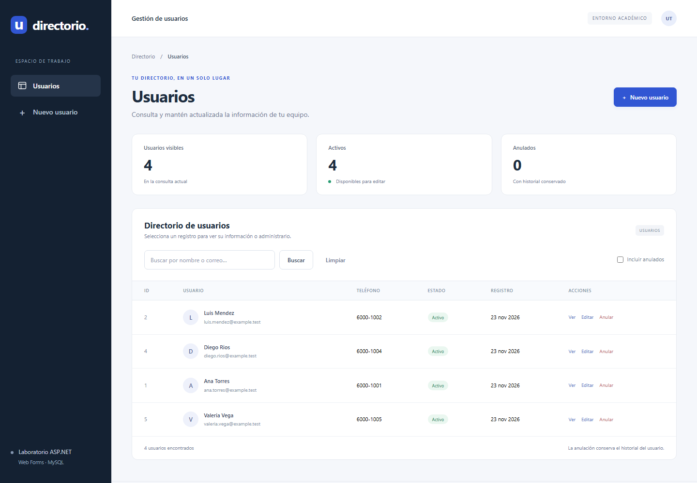
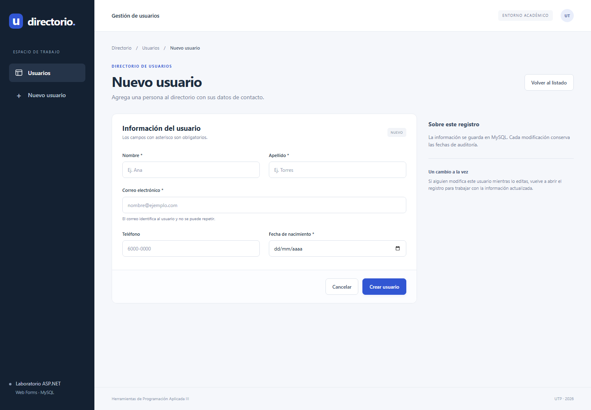
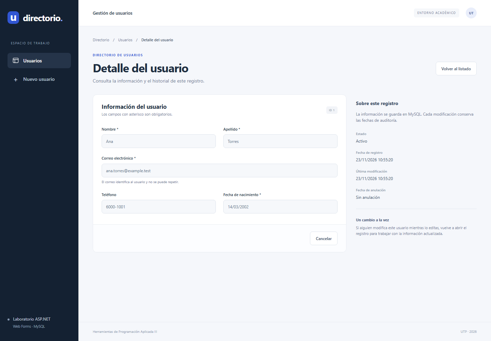
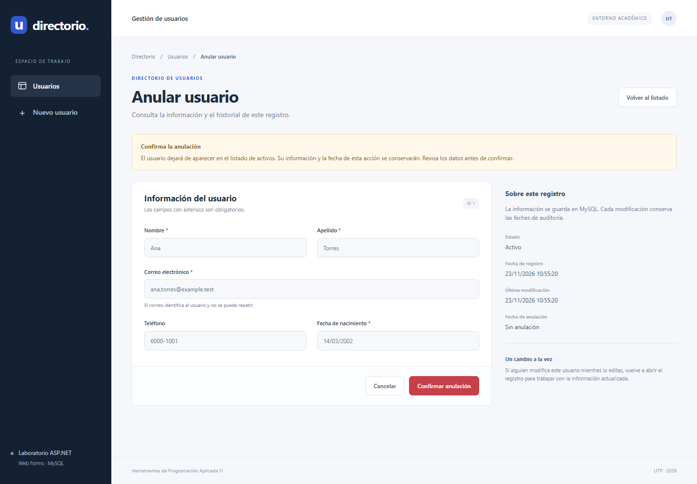

# Laboratorio CRUD de usuarios con ASP.NET

Este repositorio desarrolla un **directorio de usuarios** para el laboratorio de Herramientas de Programación Aplicada III. Permite registrar personas, consultar y buscar sus datos, actualizarlos y anular registros sin perder su historial. La aplicación es un proyecto académico para ejecutarse localmente; no incluye autenticación.

La solución usa **ASP.NET Web Forms y C# sobre .NET Framework 4.7.2**, una biblioteca de lógica separada y **MySQL 8.0.16 o posterior**. La interfaz reúne una página maestra, Bootstrap 5.3.3 y estilos propios. El acceso a datos se hace con `MySql.Data` 8.0.33 y procedimientos almacenados parametrizados.

## Interfaz en ejecución

Capturas tomadas de la aplicación local en IIS Express con datos de ejemplo. El número de usuarios visibles depende del estado de la base en cada instalación.

### Listado y búsqueda

El directorio muestra los usuarios activos, el resumen de la consulta, un buscador por nombre o correo y las acciones disponibles para cada fila. La casilla **Incluir anulados** permite consultar el historial.



### Alta de usuario

El formulario solicita nombre, apellido, correo y fecha de nacimiento; el teléfono es opcional. El correo debe ser único, incluso entre los usuarios anulados.



### Detalle y auditoría

La vista de detalle presenta los datos sin permitir cambios y muestra el estado y las fechas de registro, última modificación y anulación.



### Anulación con confirmación

La anulación requiere una confirmación explícita. El registro permanece en MySQL con estado inactivo y fecha de anulación; no se borra físicamente.



## Qué se implementa

| Operación | Comportamiento |
| --- | --- |
| Crear | Valida los campos, normaliza el correo y registra una persona. |
| Leer | Lista usuarios activos, busca por nombre, apellido o correo y abre el detalle por ID. |
| Actualizar | Carga el registro seleccionado y guarda sus cambios. Detecta si otra edición modificó el registro entretanto. |
| Anular | Pide confirmación, cambia el estado a inactivo y conserva los datos y la auditoría. |
| Consultar historial | Incluye anulados en el listado y permite ver su detalle, sin volver a editarlos o anularlos. |

La tabla `usuarios` guarda ID, nombre, apellido, correo, teléfono, fecha de nacimiento, estado y tres fechas de auditoría. MySQL garantiza la unicidad del correo. Los procedimientos `sp_load`, `sp_read`, `sp_create`, `sp_update` y `sp_delete` implementan las operaciones de persistencia. La edición y la anulación comparan `FechaModificacion` para evitar sobrescribir cambios concurrentes.

## Organización del repositorio

| Ruta | Contenido |
| --- | --- |
| `Diseno/` | Proyecto web: `Site.Master`, listado, formulario, estilos y eventos de interfaz. |
| `Logica/` | Modelo `Usuario`, validaciones, servicio y repositorio MySQL. |
| `Database/` | Scripts para crear la base, tabla, procedimientos y datos ficticios. |
| `Pruebas/` | Pruebas ejecutables del servicio y modo opcional de integración MySQL. |
| `docs/` | Arquitectura, casos de prueba, rúbrica y evidencias. |

Las páginas llaman a `UsuarioServicio`; las consultas a MySQL están en `MySqlUsuarioRepositorio`, fuera del código de interfaz. El proyecto de pruebas sustituye el repositorio por uno simulado para verificar las reglas sin depender de MySQL.

## Ejecutar localmente

1. Instala Visual Studio Community con **Desarrollo de ASP.NET y web**, el targeting pack de **.NET Framework 4.7.2** e **IIS Express**. Instala también MySQL 8.0.16 o posterior.
2. Abre `LaboratorioCrudAspNet.sln` y restaura los paquetes NuGet.
3. Crea la base `laboratorio_crud` ejecutando `Database/00_instalar.sql` en MySQL Workbench con una cuenta que pueda crear la base y los procedimientos. El script incluye cinco usuarios ficticios (`example.test`). También puedes usar `.\Database\Instalar_database.ps1 -Usuario root` desde PowerShell; el cliente MySQL pedirá la contraseña.
4. Configura la cuenta de la aplicación en `Diseno/App_Data/Conexion.local.config`. El archivo está excluido de Git. Puedes generarlo con `.\Configurar_conexion.ps1 -Usuario TU_USUARIO -Sobrescribir`; agrega `-SolicitarContrasena` si esa cuenta requiere contraseña. El script no crea cuentas de MySQL: usa una cuenta existente con acceso a la base y permiso para ejecutar los procedimientos. `Database/06_usuario_app_ejemplo.sql` muestra cómo crear una cuenta de permisos limitados; cambia su contraseña de ejemplo antes de usarlo.
5. Establece `LaboratorioCrud.Web` como proyecto de inicio y ejecuta con IIS Express. `Default.aspx` redirige al listado `Pages/Index.aspx`. En la configuración incluida, la URL HTTP es `http://localhost:51840/`; Visual Studio puede asignar otro puerto.

Bootstrap se carga desde un CDN; para verlo con ese estilo se necesita acceso a internet. Los estilos de `Diseno/Content/site.css` mantienen la interfaz funcional sin el CDN.

### Compilar y probar

Desde **Developer PowerShell for Visual Studio**, en la raíz del repositorio:

```powershell
msbuild LaboratorioCrudAspNet.sln /restore /p:Configuration=Debug
.\Pruebas\bin\Debug\LaboratorioCrud.Pruebas.exe
```

Las pruebas normales usan un repositorio simulado. El modo `--mysql` requiere una base aislada cuyo nombre termine en `_test` y la variable `CRUD_TEST_CONNECTION`; consulta [docs/PRUEBAS.md](docs/PRUEBAS.md) antes de ejecutarlo. Si la aplicación muestra un error de conexión, ejecuta `Diagnosticar_conexion.cmd` desde la raíz para revisar la configuración, abrir la conexión y probar el listado sin modificar datos.

## Documentación adicional

- [Arquitectura y flujo de las operaciones](docs/ARQUITECTURA.md)
- [Pruebas de aceptación](docs/PRUEBAS.md)
- [Relación con la rúbrica](docs/RUBRICA.md)
- [Validación realizada](docs/VALIDACION_REALIZADA.md)

Esta aplicación está pensada para `localhost`. Antes de exponer datos de personas en un entorno compartido se necesita agregar autenticación y autorización.
